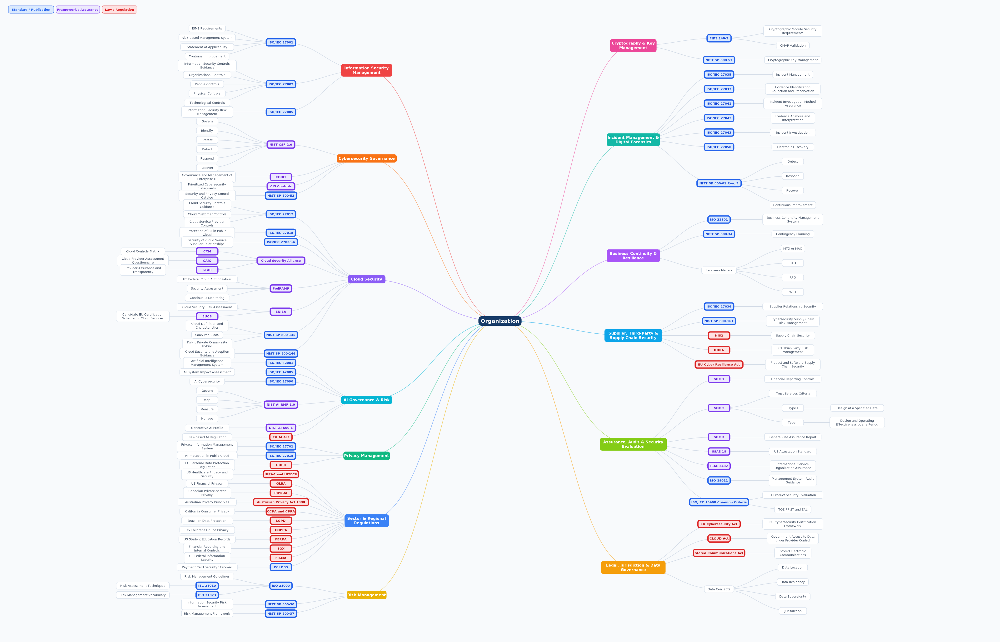

# Cybersecurity Standards, Frameworks & Regulations

An organization-centered reference mapping major cybersecurity standards, frameworks, regulations, assurance mechanisms, and governance domains.

[](assets/cybersecurity-grc-framework.png)

## Browse by domain

| Domain | Content |
|---|---|
| [Information Security Management](docs/information-security-management.md) | ISO/IEC 27001, 27002, 27005 |
| [Cybersecurity Governance](docs/cybersecurity-governance.md) | NIST CSF 2.0, COBIT, CIS Controls, NIST SP 800-53 |
| [Cloud Security](docs/cloud-security.md) | ISO cloud standards, CSA, FedRAMP, ENISA, NIST cloud guidance |
| [AI Governance & Risk](docs/ai-governance-risk.md) | ISO/IEC 42001, 42005, 27090, NIST AI RMF, EU AI Act |
| [Privacy Management](docs/privacy-management.md) | ISO/IEC 27701, 27018, GDPR |
| [Sector & Regional Regulations](docs/sector-regional-regulations.md) | HIPAA, GLBA, PIPEDA, CCPA/CPRA, LGPD, PCI DSS, and others |
| [Risk Management](docs/risk-management.md) | ISO 31000 family, NIST SP 800-30 and 800-37 |
| [Cryptography & Key Management](docs/cryptography-key-management.md) | FIPS 140-3 and NIST SP 800-57 |
| [Incident Management & Digital Forensics](docs/incident-forensics.md) | ISO/IEC 27035, 27037, 27041, 27042, 27043, 27050, NIST SP 800-61 |
| [Business Continuity & Resilience](docs/business-continuity.md) | ISO 22301 and NIST SP 800-34 |
| [Supplier, Third-Party & Supply Chain Security](docs/supply-chain-security.md) | ISO/IEC 27036, NIST SP 800-161, NIS2, DORA, CRA |
| [Assurance, Audit & Security Evaluation](docs/assurance-audit-evaluation.md) | SOC, SSAE 18, ISAE 3402, ISO 19011, Common Criteria |
| [Legal, Jurisdiction & Data Governance](docs/legal-data-governance.md) | EU Cybersecurity Act, CLOUD Act, SCA |

## Repository structure

```text
.
├── README.md
├── LICENSE
├── CHANGELOG.md
├── CONTRIBUTING.md
├── assets/
│   └── cybersecurity-grc-framework.png
├── docs/
│   └── one readable Mermaid map per domain
└── src/
    └── full-map.md
```

The overview image is optimized for browsing. Each domain page contains a smaller GitHub-renderable Mermaid map. The complete hierarchy remains available in `src/full-map.md` as the master source.
