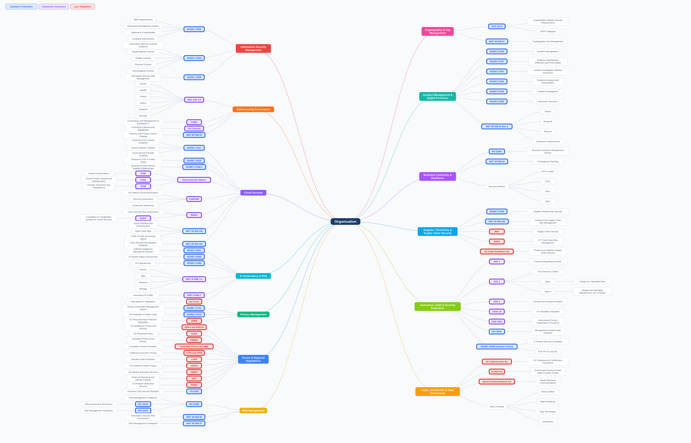

# Cybersecurity Standards, Frameworks & Regulations

An organization-centered map of major cybersecurity standards, frameworks and regulations.

## Browse by domain

- [Information Security Management](docs/information-security-management.md)
- [Cybersecurity Governance](docs/cybersecurity-governance.md)
- [Risk Management](docs/risk-management.md)
- [Cloud Security](docs/cloud-security.md)
- [AI Governance & Risk](docs/ai-governance-risk.md)
- [Privacy Management](docs/privacy-management.md)
- [Cryptography & Key Management](docs/cryptography-key-management.md)
- [Incident Management & Digital Forensics](docs/incident-forensics.md)
- [Business Continuity & Resilience](docs/business-continuity.md)
- [Supplier, Third-Party & Supply Chain Security](docs/supply-chain-security.md)
- [Payment Security](docs/payment-security.md)
- [Assurance, Audit & Security Evaluation](docs/assurance-audit-evaluation.md)
- [Sector & Regional Regulations](docs/sector-regional-regulations.md)

## Assets

- `assets/cybersecurity.svg` - primary scalable visual
- `assets/cybersecurity.png` - high-resolution raster export
- `src/full-map.md` - complete editable hierarchy

The map uses one primary home for each reference: standards and frameworks are grouped by function, while laws and regulations are grouped primarily by jurisdiction.
